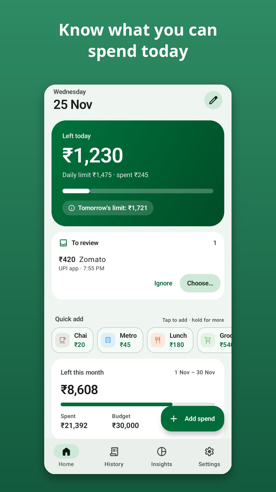
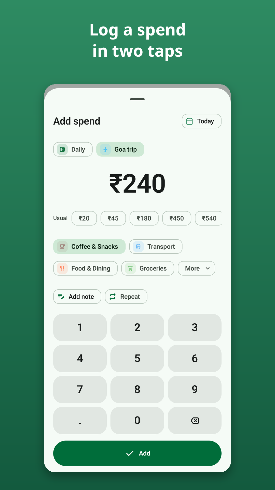
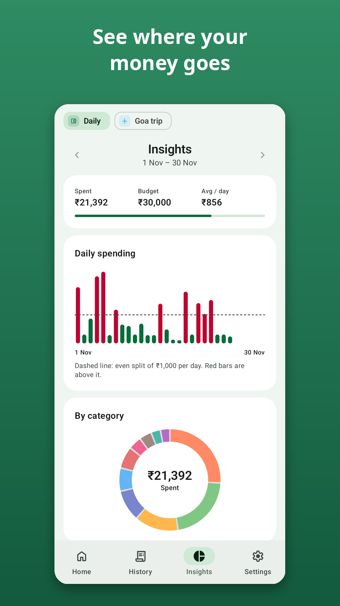
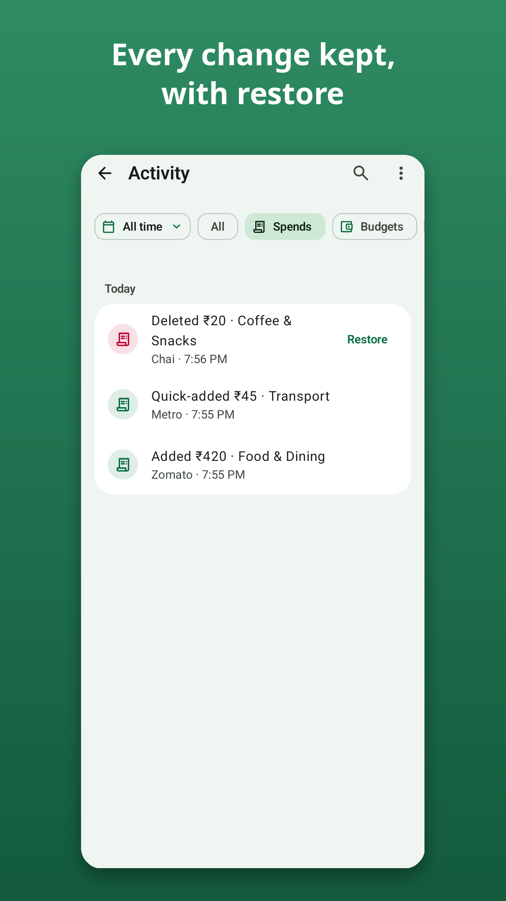

<div align="center">


# DayPurse

**A private, offline budget that tells you what you can spend today.**

Set a weekly, monthly or custom budget and DayPurse turns it into a daily limit that adapts:
overspend today and tomorrow's limit drops; spend less and it rises.

No internet permission. No accounts, ads or analytics. Your data never leaves your phone.

[Features](#features) · [Privacy](#privacy) · [Build](#build) · [Contributing](CONTRIBUTING.md) · [Changelog](CHANGELOG.md)

<!-- Store badges: add once the listings are live.
[](https://f-droid.org/packages/in.bizappz.daypurse/)
[](https://play.google.com/store/apps/details?id=in.bizappz.daypurse)
-->

</div>

<p align="center">
  
  
  
  
</p>

## Features

- **Daily limit that adapts.** Money left ÷ days left, fixed for the day. See tomorrow's limit as you spend.
- **Several budgets.** A main daily budget plus trips, festivals or anything else: weekly, monthly (any start day)
  or custom dates, with optional carry-over, repeat and pause.
- **Fast logging.**
  - Quick add: spends you repeat become one-tap chips (with Undo).
  - Launcher shortcuts, a Quick Settings tile and two home-screen widgets.
  - Reply to the daily reminder with "120 food" to log a spend without opening the app.
  - Recurring spends (rent, subscriptions) are added automatically.
- **Payments from notifications (optional).** Spots payments in UPI apps, bank apps and bank text messages and asks
  whether to log them. Nothing is logged until you tap *Log*; it learns the category you use for each payee.
- **History and insights.** Month by month with filters, a daily chart and category breakdown.
- **Activity history.** Everything you added, changed or deleted, with filters, search and *Restore* for deleted
  spends. Kept for 90 days by default (configurable).
- **Yours to keep.** JSON backup and restore, CSV export, biometric app lock, light/dark themes and accent colours.

## Get DayPurse

| Where | What you get |
|---|---|
| F-Droid | DayPurse (listing coming soon) |
| Google Play | DayPurse (listing coming soon) |
| [GitHub releases](https://github.com/gh-yash/daypurse/releases) | `DayPurse-<version>.apk` and `DayPurse-Lite-<version>.apk` |

F-Droid installs the same APK, signed with the same key, as the GitHub release (it's
[reproducible](docs/RELEASING.md#reproducible-builds)), so you can switch between them without losing data.

**DayPurse Lite** is everything except payment spotting, so it never asks for notification access. In some
countries, including India, Play Protect blocks installing apps that ask for notification access when the APK
comes from a browser, chat app or file manager; Lite installs normally. It installs next to the full app; to move
your data, use *Settings → Export backup* in one and *Restore from a backup* on the other's first screen.

## Privacy

DayPurse has **no internet permission**, so it cannot send anything anywhere. There are no accounts, ads, analytics
or crash reporters. See the [privacy policy](PRIVACY.md).

| Permission | Why |
|---|---|
| Notifications | The daily reminder and "Log this payment?" prompts (both optional). |
| Run at startup | Re-arms the daily reminder after a reboot. |
| Biometrics | Optional app lock, using Android's own prompt. |
| Notification access | Optional, granted by you in system settings: reads payment notifications from the apps you pick. Only the amount, payee, app and time are kept. |
| See listed apps | Shows which supported payment apps are installed (a fixed list, not all your apps). |

## Requirements

Android 12 or newer.

## Build

You need JDK 21 or newer and the Android SDK (Android Studio installs both).

```bash
./gradlew testFullDebugUnitTest   # unit and Robolectric tests, no device needed
./gradlew lintFullDebug           # Android lint
./gradlew assembleFullDebug       # debug APK, installs next to the release app as "DayPurse (debug)"
./gradlew assembleLiteDebug       # DayPurse Lite debug APK
./gradlew assembleFullRelease     # release APK, reproducible (unsigned without keystore.properties)
scripts/build-release.sh          # all signed release files: APKs for GitHub/F-Droid, bundle for Play
```

There are two editions (Gradle flavors): `full` and `lite`, which leaves out payment spotting. To sign release
builds, copy `keystore.properties.example` to `keystore.properties` and fill it in.

More: [architecture](docs/ARCHITECTURE.md) · [releasing](docs/RELEASING.md)

## Tech

Kotlin, Jetpack Compose (Material 3), Room, DataStore and coroutines. No Google Play Services and no proprietary
libraries. Manual dependency injection and no background services (one daily alarm if the reminder is on).
Release builds are [reproducible](docs/RELEASING.md#reproducible-builds).

## Contributing

Bug reports, ideas and pull requests are welcome. Please read [CONTRIBUTING.md](CONTRIBUTING.md) first.

## License

Copyright © 2026 Yash Kumar.

DayPurse is free software: you can redistribute it and/or modify it under the terms of the
[GNU General Public License v3.0 or later](LICENSE).

Icons are [Material Symbols](https://github.com/google/material-design-icons) by Google, Apache License 2.0.
